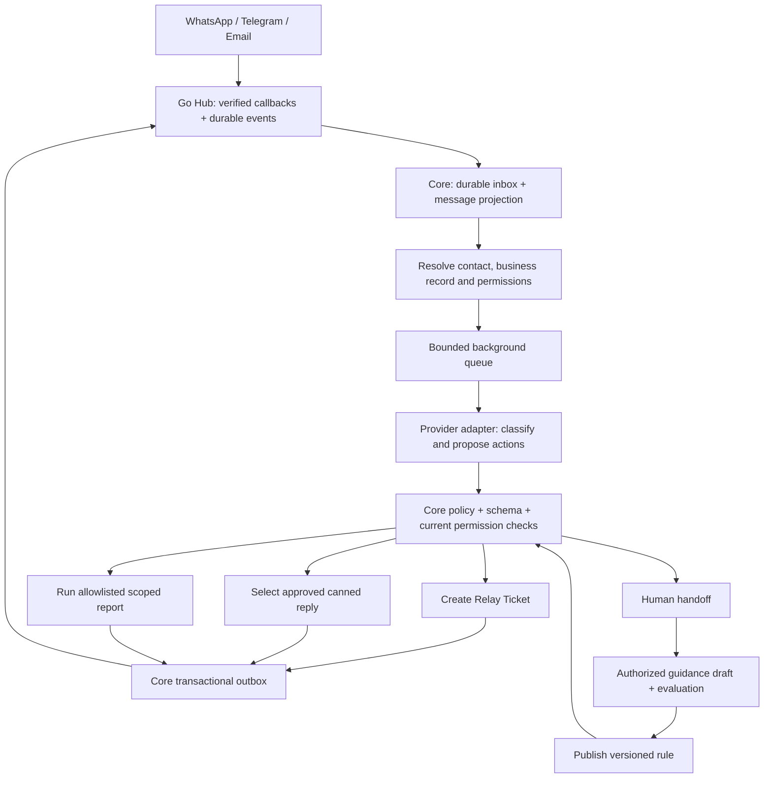

# Relay AI automation — implementation plan

Status: planned, not deployed. Builds on the targeted Jarvis source review at commit 15574fe64849b024fe4285bad8c2ed0bfe79ede5; architectural patterns only, no copied implementation. All work stays on develop in relay_hub and frappe_relay_core. No production migrations, provider sends, pushes or changes to other developers' working copies as part of this plan.

## Architecture

Core owns AI, business authorization and workflows; no I2A dependency. Hub owns transport, provider credentials, account isolation, rate limits, delivery reconciliation and channel MCP tools. Core UI/API/MCP share the same action services. A model proposes identifiers and constrained arguments; it cannot execute arbitrary Python, SQL, HTTP, Frappe methods or change policy.

## Current foundation and prerequisite gaps

Present: Hub durable WhatsApp delivery/event infrastructure, Core callback event storage, permission-checked ticket service source, and bounded contact search endpoint/browser adapter. Core preview uses sample data; source DocTypes have not been migrated to a live test site. Telegram/email transport, event-to-message projection, business endpoint mapping and agent assignment rules are unfinished. Existing owner-only tickets are insufficient for shared team operations. Live behavior cannot be inferred from the passing mock tests.

## 1. Durable incoming messages and contact scope

Implement the projection from Relay Hub Event into Relay Message with unique (Hub account, channel, provider event/message ID) keys and cursor checkpoints. Normalize incoming messages, edits, reactions and statuses separately: delivery statuses must never trigger AI replies. Retain bounded original metadata needed for reconciliation. Import attachment metadata first, fetch bytes only when needed under limits.

Add Relay Contact Endpoint and Relay Business Link associations around existing Frappe Contacts. One endpoint may belong to several legitimate business references; one customer can have many Contacts/endpoints. Resolve using verified channel/account identity, not user-provided sender fields. Unknown or ambiguous identities enter uncategorized/handoff; no report execution. A selected customer context must not silently switch to supplier context. Email sender matching alone must not authorize sensitive report delivery; define verification and re-verification before enabling each action.

Permission context contains site/account, execution user, team, contact, endpoint, selected business record and permitted actions. Use a dedicated least-privileged execution user, never Administrator; record the initiating identity separately. Check both current Frappe access and explicit external-contact entitlement at execution and artifact download. Team query filters, document checks and attachment access must agree across Desk, custom UI, REST and MCP.

Deliverable gate: duplicate callbacks produce one message; cross-account and cross-business requests are denied; unknown contacts cannot receive private data.

## 2. Configuration and auditable run records

Create Relay AI Provider (provider kind, model, capability flags, timeout and cost settings; secrets in protected Password fields), Relay Automation Policy (scope, enabled actions, provider routing, quotas, fallback and version), Relay Canned Reply (type, language, channels, body, AI-use permission and publication version), Relay Automation Run, Relay Automation Action, Relay Automation Outbox and Relay Guidance. Reuse Relay Ticket and Relay Ticket Message; add assignment, business reference and source-action link. Add child DocTypes only where needed, all prefixed Relay, with sequential names. Unique natural event/action keys supplement sequential primary names.

System Manager configures credentials/channels and execution identity. Relay Communication Manager publishes policies/canned replies/guidance and assigns tickets within allowed scope; Relay Communication User operates assigned conversations/tickets. Nobody gains broader business access from their Relay role. Immutable action proposals record policy/model versions, sanitized inputs, selected reply/version, outcome, reason, latency and usage; no secrets or hidden model reasoning. Define retention for transcripts, attachments and runs, plus deletion/revocation behavior for associated artifacts.

## 3. Provider-independent decision service

Adapters: OpenRouter, Gemini and Anthropic initially; direct OpenAI as an additional adapter with capabilities verified against its supported API. Codex/Claude local CLI execution is not a production credential strategy; a CLI-backed development adapter, if added, must be explicit and isolated. No model IDs assumed universally available.

One normalized request/response contract supports text and structured decisions first; add separately tested image/voice adapters with size, duration, MIME and language limits. Preserve original text/transcription and selected language. No silent translation of an approved canned reply; use a published language variant or hand off. Unsupported media/model capability routes to handoff.

Fetch a bounded set of permitted canned replies and approved guidance server-side; do not send entire contact/message tables to the model. Configure context/token limits, at most two model attempts within a total deadline, provider-specific retry rules and permitted data destinations. Fallback cannot send data to a provider outside policy. Quotas cover all attempts and retries; quota exhaustion, malformed output, low calibrated confidence or outage causes a durable handoff.

Strict result schema: intent, category, brief, permitted reply ID or null, and proposed actions from an enum. Reject unknown keys, arbitrary recipient overrides, tools and report names outside policy. Treat user messages, documents and retrieved guidance as untrusted data; prompts are not authorization. Start with one bounded decision round, not an unrestricted agent loop.

## 4. Automatic ticket + canned-reply execution

First vertical slice: incoming text/payment evidence -> classify -> create ticket if authorized -> select a published reply -> enqueue acknowledgement -> show run/ticket in Core. Screenshot classification never verifies settlement or posts accounting entries. Unknown requests use a configured approved acknowledgement such as “Our team will contact you soon” when channel policy permits, and enter the team's handoff queue.

Run states: Pending, Claimed, Deciding, Validated, Applying, Completed, Handoff, Retryable failure, Failed, Cancelled. Claim using a database lease with expiry and fencing token; no transaction held open during model/provider calls. Per-conversation sequence plus current human/bot ownership prevents two workers responding to the same turn. Immediately before applying, recheck enabled policy/version, current permissions, human takeover and whether the triggering message was superseded/deleted.

Stable action key derives from source event + automation purpose + action slot, not generated model text or worker attempt. A unique constraint guards each action. A transaction creates ticket, action result and outbound intent together. The relay outbox is the durable source of truth; after-commit queue publication accelerates dispatch, with periodic recovery for the commit/enqueue crash gap. Outbox workers submit the stored immutable payload to Hub with the same stable key on retries. Changed payload under an existing key is a conflict, never an implicit second send. Hub acceptance is not delivery: preserve submitted/uncertain/failed/delivered states and reconcile receipts. Unknown provider outcome is not retried with a fresh key. Promise deduplicated effects and reconciliation, not universal exactly-once network delivery.

Retries must not rerun a committed decision or recreate a ticket. Execution failures after ticket creation retain the ticket and retry the outbound intent. Human handoff is durable, assigned to a configured team, visible in the inbox and pauses bot replies until explicit resume. Commands to pause/disable take effect before dispatch; already accepted provider messages cannot be unsent by a kill switch.

## 5. Notifications, reports and learning

Ticket-update notifications use email or Telegram only, with explicit verified recipient preference, subscription settings and a dedup key per ticket revision/recipient/channel. WhatsApp ticket-update notifications remain disabled. Initial WhatsApp canned acknowledgements still obey the provider's permitted messaging window/template rules; if unavailable, show a pending human task rather than silently sending another channel.

Add reports only after contact authorization tests pass. Expose named approved report actions, fixed customer/supplier/company filters from server-resolved context, validated date ranges and output/row/time limits. Background generation produces private files with recipient-scoped expiring access or authorized channel attachments. Recheck authorization before retrieval/delivery; no model-generated query and no leakage through aggregates or cached files. Missing identity or ambiguous roles means handoff.

Human corrections store explicit proposed guidance, evidence and scope. Manager reviews/publishes a version after evaluation; authorized published guidance can then be used automatically without per-message review. Rules are disableable and reversible. Learning cannot create new tool permissions. Track category corrections, canned-reply acceptance, unwanted handoffs, unsafe-action refusals and ticket duplication using labeled outcomes; model confidence is not measured accuracy. Add multilingual text, voice and screenshot evaluation sets incrementally.

## 6. Core UI and API/MCP contract

Frappe-styled shared components: Automation settings, provider configuration, canned-reply library, run/activity panel, ticket list/detail and human handoff queue. Keep explanatory implementation text out of the normal interface. Show concise status, reason, assignee and retry/resume controls with role checks. Ticket message links load a bounded window around the source cursor, including reverse scrolling. Search runs in the database; page size 50, capped browser cache and virtual rows. Attachment viewers are lazy and permission checked.

Core services: automation preview (no writes/sends), run enqueue/status, policy publish/disable, canned reply publish, handoff claim/resume, ticket actions and approved report requests. MCP uses the same handlers and validates all nested arguments. Hub exposes channel capability/send/bulk/status tools; it does not execute business reports. Preview uses isolated action planning, never rollback around real side effects.

## 7. Resource limits and validation

Initial configurable limits: one AI job per conversation, two per site, global worker cap; bounded queue depth and admission control; 50-row pages; 200-row browser cache; bounded model context; limited attachment bytes/pages/duration. Overload persists work and exposes queue age; no unbounded workers or threads. Share fair capacity across accounts. Increase concurrency only after measured load tests; initial deployment is bounded workers, not a claim of infrastructure autoscaling.

Tests before enabling automatic actions:
- Real isolated Frappe installation/migrations, role and record-access tests for UI, direct APIs and MCP.
- Duplicate and out-of-order events; two workers; restart after each transaction/network boundary; lease expiry; Redis outage; model outage; uncertain Hub result; revoked policy/user; human takeover mid-inference.
- Prompt injection, forged sender, cross-customer/company report requests, secret redaction, attachment access, reused artifact links and quota bypass.
- End-to-end test-channel messages for ticket + reply, handoff/resume, email/Telegram notifications and report PDF. Test provider credentials required; no actual customer sends.
- Large synthetic history/search datasets, desktop/mobile browser memory, queue lag, p50/p95/p99 endpoint latency, worker RAM and DB query plans. Set performance release thresholds from the measured baseline and record hardware/concurrency/provider latency separately.
- Gold evaluation cases in Tamil and English initially, expanded per usage. No release on failed authorization, duplicate-effect or data-isolation tests. Establish category/reply quality thresholds from reviewed examples before automatic rollout.

Rollout: isolated installation -> replay/shadow decisions without side effects -> dedicated test conversations -> restricted canary policies -> wider enablement. Retain per-site/channel/action kill switches, migration backup/rollback procedure and durable recovery records. Report what is proven versus mocked. Do not push incomplete integration as release-ready.

## Build order

1. Message projection, identity scope, team permissions and real test installation.
2. Policy/canned/provider/run records and strict decision adapters; shadow evaluation.
3. Idempotent ticket + acknowledgement vertical slice and visible handoff.
4. Production Core UI wiring and MCP contracts; failure/load tests.
5. Telegram/email adapters and ticket notifications, then scoped reports.
6. Voice/vision, reviewed guidance learning and broader provider coverage.

Calls remains a separately tracked feature with WhatsApp first; it is not a prerequisite for text automation and not silently included as an autonomous AI action.

## Review amendments — controlling details

These provisions resolve the GLM review findings and take precedence over less specific wording above.

### Verified identity and notification recipients

Endpoint verification states are Unverified, Pending, Verified, Revoked. A trusted channel callback authenticates the provider event, not the person's entitlement to a customer/supplier record. Business-link authorization requires a manager-approved enrollment, or a pre-authenticated business portal linking the endpoint. Email enrollment additionally uses a single-use expiring challenge sent to the approved address; merely receiving a reply in an existing thread does not verify it. Changing addresses/business associations invalidates prior grants. Define expiry and re-verification intervals in policy, with immediate revocation.

Only authentication verdicts from the configured trusted email receiver are accepted; ignore spoofable Authentication-Results headers supplied by the sender. Failed or missing alignment verdicts route sensitive requests to handoff. SPF/DKIM/DMARC are supporting transport signals, never proof of a business entitlement. Initial sensitive report access requires authenticated portal verification even if email is verified. Unverified senders may receive a generic permitted acknowledgement and create an uncategorized internal ticket, but cannot receive business records or enroll notification recipients. Notification destination changes are authorized and audited, never inferred from message text. Suppress auto-response loops (own outbound messages, bot echoes, email auto-submitted messages, duplicate forwarded events) before model invocation.

### Decision and ticket uniqueness

Unique Relay Automation Run key: (site/account, normalized incoming message identity, automation purpose). Event retries resolve that existing run, including Completed. Persist the validated decision before execution using a compare-and-swap on run version/fencing token. A second worker cannot overwrite it. An expired worker's commit is rejected; record a sanitized stale-attempt metric/audit and discard its output without effects.

Relay Ticket.source_action_key has a unique constraint for automatically created tickets; manual tickets leave it unset. Canonical action-key construction is deterministic and versioned. Store and verify the same key in the action, ticket and outbox transaction. Policy changes do not create a fresh run/action key automatically. Explicit reprocessing is manager-only and defaults to evaluation-only; any additional external action requires a separately authorized new intent. Test replay after Completed, crash before/after decision persistence and concurrent ticket insertion.

### Immutable payload and conflict resolution

Store an immutable normalized payload, payload hash, recipient, published reply version and triggering turn in the outbox transaction. Ordinary Desk/API edits to submitted action/outbox records are prohibited. Hub rejects same-key/different-payload submissions using a typed conflict result (map to HTTP 409 where applicable; preserve the structured MCP error contract). Core moves the action to Conflict, pauses automatic retry, records the known submission identifier and alerts the assigned handoff team. Show only permission-checked details of the originally submitted payload; do not expose payloads across accounts. Never label an earlier submission as delivered without a receipt. Corrections require a distinct explicit action, not mutating the original intent.

### Takeover, dispatch races and recovery

Human takeover increments the conversation generation and invalidates unsent automatic intents from older generations. Resume does not revive them; reevaluate the current turn with the new ownership state. Outbox workers recheck current permissions, enabled policy, generation and cancellation immediately before submission. Use a short atomic transition to Dispatching with a fenced dispatch permit; do not hold a DB transaction across network calls. Disable/takeover is effective for actions not yet admitted to Dispatching. Already admitted or in-flight operations may complete; the UI must expose that boundary honestly and reconcile the result, rather than promising an impossible atomic switch across Core and an external provider.

Recovery sweeps run every 30 seconds initially; ordinary dispatch is event-driven. Bounded per-conversation FIFO preserves action order; terminal failure/handoff releases later actions only under explicit policy. Lease renewal and expiry are configured against the bounded total model deadline. Queue limits must never silently discard an acknowledged incoming event: defer admission while retaining durable pending work and alert on backlog age.

### Initial measurable rollout gates

These are proposed initial product acceptance limits, not claims of current performance:

- Gold set: at least 30 labeled cases per enabled intent/category in each enabled language, plus adversarial, ambiguous-contact, unsupported-media and outage cases. Separate held-out evaluation examples from guidance-development examples.
- Automated category accuracy at least 95% and canned-reply appropriateness at least 98% on the held-out enabled-scope set. Report sample counts, per-category results, automation coverage and uncertainty; a high handoff rate must not hide poor coverage. Zero cross-recipient/business leaks, permission bypasses or duplicate action effects in the test suite.
- Initial canary: explicitly enrolled test contacts only, at least seven consecutive days and 200 eligible incoming messages; manually assess every automatic reply during canary. Zero misdirected/private-data replies or duplicate ticket/send effects; any such event disables the affected automation immediately. Published reply appropriateness at least 98%; all provider failures visible and reconciled or assigned for handoff.
- Proposed local orchestration target: p95 verified-event persistence below 500 ms and p95 dispatch start below one second without provider latency, at the documented admitted load. Load-test 50 events/second for 15 minutes on recorded hardware, including a burst/backlog phase. Start with two AI jobs per site; measure sustainable AI throughput separately and defer excess durably. These are release-test targets, not a promise that two AI workers process 50 model calls/second.
- Relay Communication Manager signs off labeled quality/canary outcomes; System Manager signs off identity configuration, operational limits and enablement. This is a future product workflow, not a request for permission to write the implementation.

## Review outcome

GLM 5.3 Flash reviewed the draft and found specification gaps rather than a need to replace the architecture. The amendments above address the four stated blockers and race cases. Primary-agent second pass checked those amendments for misleading guarantees: rejected thread-reply-only email verification, preserved MCP conflict semantics, distinguished submitted from delivered, and stated the true in-flight cancellation boundary. The revised plan is ready to guide staged implementation. No deployed safety/performance claim follows from a plan review; release still requires the stated tests.
