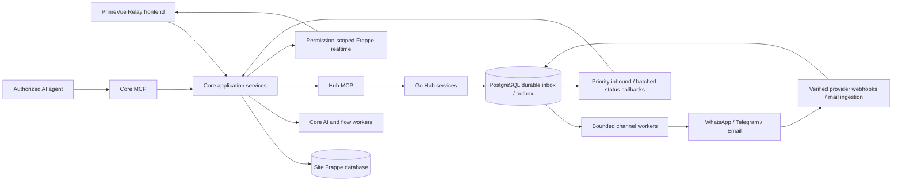

# Relay Core and Relay Hub — implementation design

Status: architecture and first isolated foundation work, 21 September 2026. Incorporates Telegram 11434 (late delivery), 11435 and earlier requirements. The approved Frappe-style preview remains the visual reference. The user selected Relay in Telegram message 11472. Product names: Relay Core (Frappe) and Relay Hub (Go). All new DocTypes, including child DocTypes, use the full `Relay` prefix; package names are planned as `relay_core` and `relay_hub`. Brand/package availability has not been verified. No production migration or provider operation is performed by this work.

## 1. Product and boundaries

Relay Core is installed as a normal Frappe app on each site and uses the host site login, sessions, roles, User Permissions and API-key authentication. It does not provide a separate login page. One standalone Go Hub serves multiple Frappe Core sites. An account belongs to exactly one site; a site may have multiple accounts, each enabling selected channels. Core owns business records, permissions, workflows, AI and the user interface. Hub owns transport, provider credentials, delivery queues, channel/template reconciliation and call transport. Do not rebuild Contact, Customer, Supplier, Employee, Sales Person or Sales Partner masters. No external I2A dependency.

Browser APIs and MCP are adapters to the same application services. HTTP callbacks/webhooks and browser realtime remain appropriate transports; requiring MCP for Core-to-Hub commands does not mean tunnelling provider webhooks through an LLM.

## 2. Existing implementation findings

Read-only inspection of `frappe-v15/apps/frappe_whatsapp_core`:

- `conversation_reads.py` already separates provider receipts from local operator reads, stores exact message readers, has a conversation cursor and an open baseline. Preserve these distinct concepts; replace provider-time cursor ordering with stable local ingestion sequence for the new schema.
- `conversation_presence.py` already uses per-browser-tab cache entries and expiring presence, and broadcasts when visible viewers change. Reuse the approach with namespaced keys and the new permission policy.
- `permissions.py` includes team-contact and assigned-team visibility. This differs from the requested agent-only-assigned policy. Do not blindly copy its query conditions.
- `contact_presentation.py` batches presentation, but its default uses a primary link. The new business-record projection must expose all permitted matches and category membership, with primary used only for display preference.
- Folder DocTypes, Important navigation, Contact Summary, call history and call artifact handlers already exist. Audit behavior against acceptance tests before porting.
- `core_ui/src/features/calling/services/whatsappWebRTC.js` mixes local and remote audio and accumulates recording chunks until stop. Memory therefore grows with recording duration. Replace unbounded accumulation with bounded chunk upload or a dedicated media recording path; do not claim a recording exists merely because a call connected.
- Existing Hub found under `frappe-v16/apps/frappe_whatsapp_hub`; webhook/template processing and calling APIs are reference implementations, not the destination runtime.

This was targeted code inspection, not a completed security or performance audit. Existing repositories were not edited.

## 3. Relay component foundation

Build one versioned Relay-owned component adapter on PrimeVue unstyled primitives, shared by Core and the Go Hub administration frontend. Map that layer to Frappe-compatible semantic tokens rather than maintaining independent form styling. Core reads permitted DocType metadata; Hub exposes the same presentation schema without depending on a Frappe server.

| Family | Required behavior |
|---|---|
| Data, Small Text, Text, Long Text | Length rules, placeholder, required/read-only, errors |
| Select, Check | Metadata options, correct empty/false handling |
| Link, Dynamic Link | Server permission-filtered search, debounce, cancellation, pagination; Dynamic Link depends on selected DocType; revalidate on save |
| MultiSelect, Table MultiSelect | Chips, deduplication, permitted linked records; correct Frappe child-row serialization |
| Int, Float, Currency, Percent | Locale display, precision, numeric validation; monetary payloads preserve decimal precision |
| Date, Datetime, Time, Duration | Site/user timezone conversions, explicit transport format |
| Attach, Attach Image | Private upload, progress, size/type limits, permission-scoped download |
| Table | Add/edit/reorder rows, child metadata, per-cell errors, parent validation |
| Text Editor, Markdown, Code, JSON | Appropriate editor and safe rendering; no arbitrary script execution |
| Password, Color, Rating and specialized fields | Explicit renderer or controlled unsupported-field error until implemented; never silently turn every type into a text box |
| Tab Break, Section Break, Column Break | Frappe ordering, collapsible sections, responsive columns, optional labels |

Support defaults, description only when useful, depends_on/mandatory_depends_on/read_only_depends_on through a restricted expression evaluator, field permission levels, dirty state, save/cancel, server field errors and optimistic concurrency using modified/version. Existing Frappe client scripts do not automatically run in a standalone Vue frontend: define supported hooks explicitly. Server validation remains authoritative. No full-compatibility claim until the field/layout matrix passes fixtures against the installed Frappe version.

First component set: DocumentForm, FieldRenderer, LinkField, MultiLinkField, ChildTable, DocumentLayout, FieldError, RecordPicker. Screens consume this set rather than duplicating each field.

## 4. Core navigation and interaction design

- **Inbox:** personal folders and category filters; conversation list; message timeline; optional details. Compact controls, neutral Frappe tokens, avatars only for useful contact/viewer information. Important is a personal flag, not a global conversation status.
- **Contacts:** views by configured business DocType (Customer, Supplier, Employee, Sales Person, Sales Partner or another allowed master). Show multiple business links. Uncategorized is a separate queue.
- **Dashboard:** personal assigned/open/unread/important counts, folders and category counts; managers can switch to site/team overview within their permissions. Counts never reveal unauthorized rows.
- **WhatsApp channels:** account/number details, templates and sync status, calling settings/history. WhatsApp Managers can manage these without System Manager. Templates are authored in Core, submitted through Hub, and updated from provider events via Hub.
- **Flows:** WhatsApp and Telegram visual editor, slash-command triggers, versioned test/publish, inputs, conditions, actions, replies and handoff. No email flow builder.
- **Campaigns:** recipient selection, channel/template, validation, preview, enqueue progress, delivery results and cancel-unsent.
- **Settings:** Teams, members, onboarding permissions, contact mappings, channels, canned responses, Core AI configuration and scoped integrations.

Timeline and compact summary are two views of the same authorized conversation. Compact view groups daily/weekly/monthly summaries in the user's selected timezone, shows covered dates and source-message links, and offers expand-to-messages. Summaries are asynchronous and cached by covered sequence range, prompt/model version and content revision. New messages mark the affected summary stale. Never hide newer messages behind an apparently current summary.

## 5. Read, unread and presence semantics

Use `(user, conversation)` state, not one global unread Boolean. Allocate a monotonic local sequence when a message is committed; provider timestamps are display data and may arrive late or out of order.

1. Opening a chat captures an ingestion high-water mark H and the user's previous viewport anchor in one API response.
2. Clear that user's badge only for inbound messages through H. Every chat opens at its first unread message in thread order, with an unread divider and a bounded page around it, or at the newest message if none is unread. The thread keeps that message, or the newest message, in place while media and other parts of bubbles load.
3. New messages above H remain unread unless the active foreground view acknowledges them. A background tab cannot clear newly arriving messages.
4. Update viewport anchor on actual viewing/leave with a version token. Keep it distinct from monotonic seen/read progress: scrolling backward must remain a valid resume location; stale tabs must not overwrite a newer viewport session.
5. Record exact visible message IDs in bounded batches for “read by” details. Merely opening a long chat does not fabricate exact readership for every historical message.
6. Presence is an expiring heartbeat per tab; avatars show active viewers, not proof of reading. Last read is durable, viewer presence is ephemeral, provider customer-read receipt is a third separate fact.
7. Folder/category counts use the same per-user unread predicate and permission filter. Opening in one folder clears the same conversation in other folders; global totals count distinct conversations even if categories overlap.

API: `conversation.open(id)` returns `{snapshot_seq, previous_anchor, page, state_version}`; `conversation.acknowledge_open(id, snapshot_seq)` is monotonic and authorized; `conversation.viewed(id, message_ids, anchor, version)` validates membership and size. Never accept a caller-supplied arbitrary user ID or a sequence beyond the committed high-water mark.

## 6. Business-record mapping without an identity-management UI

Core has a configured Business Type mapping: DocType, contact relationship fields, permitted display fields and matching rules. Existing Contact Dynamic Links and phone/email children are the default source; additional adapters support other approved relationships.

A private endpoint index is still necessary for routing: account/channel plus normalized address or provider chat ID. This is an implementation detail, not another master the user must maintain. Telegram uses bot + chat + optional topic IDs from inbound updates; never guess these from a contact name or phone number. Phone normalization needs country context. Email matching must not indiscriminately remove dots/plus tags or merge distinct mailboxes.

One endpoint can match multiple Contact/business records. Preserve many-to-many links and provenance. A customer who is also a supplier appears in both categories, with one transport conversation and one read state. A primary business link is a display preference, not authority to read all other records. Multiple plausible unrelated matches are flagged for review; do not auto-merge masters. No match is Uncategorized. Manager/reviewer links or rejects candidates and the action is audited.

## 7. Roles and permissions

All role names are prefixed with the final app brand. UI labels may be shorter.

| Role | Scope |
|---|---|
| Agent | Only conversations assigned to that user; reply/note/read/folders within that scope |
| Team Manager | Optional delegated role for all conversations in specifically managed teams |
| Communication Manager | All communication conversations in this Core site; assignments, teams and triage |
| WhatsApp Manager | Manage permitted WhatsApp channels, templates and flows; does not automatically grant financial-record access |
| User Administrator | Invite/onboard/deactivate app users and assign only permitted app roles; cannot grant System Manager |
| Integration Service | Narrow callback or transport capability, not interactive unrestricted business access |

User's unqualified “manager sees everything” maps to Communication Manager, scoped to one Core site, never all Hub tenants. Roles may be combined. Agent membership alone does not reveal team conversations; unassigned triage is manager-only unless explicitly assigned. Frappe Administrator behavior remains framework-controlled; do not promise to restrict the framework superuser through an app role.

Enforce the same authorization on list, detail, search/Link queries, attachments, exports, summaries, presence, counts, realtime subscriptions, DocType REST endpoints and MCP. Removing assignment or membership revokes subsequent access and subscriptions. Cache keys include scope/version. A linked business record still requires its own Frappe permission; conversation access is not permission to run a ledger report.

## 8. Proposed storage architecture

### Hub: Go + PostgreSQL

Start with Go net/http, explicit application services, PostgreSQL and bounded workers. Use the official MCP Go SDK for command transport; candidate Telegram adapter is go-telegram/bot. Pin reviewed versions during implementation. A modular single binary can run API and worker roles independently. Avoid requiring Kafka/NATS at launch: measure before adding another durable system.

Tables (each tenant-owned table carries account_id and scoped foreign keys):
- accounts, channel_connections, secret_references;
- batches, outbound_messages, delivery_attempts;
- inbound_events, normalized_messages, provider_receipts;
- callback_outbox, callback_attempts;
- templates, template_revisions, reconciliation_runs;
- media_objects, calls, recording_segments, audit_events.

Use UUID identifiers, UTC timestamps, schema-versioned JSON payloads for provider-specific extensions and normal indexed columns for routing/status. Unique `(account_id, client_message_id)` and `(account_id, channel_connection_id, provider_event_key)` provide deduplication. Foreign keys include tenant scope so references cannot cross accounts. Use account-scoped database policies plus application checks; do not derive trusted account context from request body alone.

PostgreSQL durable inbox/outbox transactions avoid acknowledging messages that exist only in memory. Workers claim ready jobs with short `FOR UPDATE SKIP LOCKED` transactions, lease owner/expiry and fencing token; release locks before network calls. Claim completion checks the current token. Lease expiration never proves that a provider did not send: handle ambiguous delivery separately. LISTEN/NOTIFY may wake workers but is not the durable queue.

Media bytes live outside relational rows. Start with private local storage behind an interface, size limits and authorized streaming. S3 stays disabled in this workspace; any later external storage is a separate deployment configuration. Production replicas require shared durable storage before horizontal media workers are enabled. Recording retention and deletion are configurable future operations, not actions performed on existing data now.

### Core: existing Frappe database

New prefixed DocTypes: Channel Account (local Hub reference), Channel, Business Type, Business Link, Conversation, Message, Conversation User State, Message View, Folder, Folder Item, Team, Team Member, Canned Response, Summary, Flow, Flow Version, Flow Run, Campaign, Campaign Recipient, Call, AI Configuration and Action Audit. These are domain groups; validate which are child tables versus independent DocTypes during schema review. Keep message history in independent records, not an ever-growing child table on Conversation.

Index assigned_user/status/activity, conversation/sequence, user/conversation, folder owner/membership and business-record links. Use cursor pagination; no full history loads or one query per contact. Personal flags and folders are never placed on shared Contact masters. Namespaced child DocTypes, roles, cache keys, realtime event names and API paths reduce conflicts. CI checks all installed DocType names before a migration; no claim of mathematically guaranteed future name uniqueness.

## 9. Delivery and realtime protocol

Core expands campaigns into durable chunks of 50, with bounded concurrent submission; Hub commits acceptance and returns per-item accepted/invalid/duplicate results. Reuse stable item IDs on retries, including retries after a Core crash. Resume campaign enumeration with a persistent cursor; don't load 2,000 recipient documents into RAM.

Workers use separate interactive and campaign lanes, per-account/channel rate limits and fair scheduling so one tenant cannot starve others. Provider rate limits override requested 50/100 messages/sec. Respect retry-after, backoff+jitter, deadline and bounded attempts. Do not claim exactly-once provider delivery: timeout after send is indeterminate unless provider idempotency/reconciliation resolves it. Retain an Unknown state and avoid automatic blind resend where duplication cannot be excluded.

Immediate durable callbacks for inbound messages, reactions and call events; statuses batched at a configurable short interval (initial proposal 250 ms or 100 events, whichever first). Cap concurrent callbacks per site with separate budgets for priority events. Repeated status transitions may be compacted in delivery projections but raw event audit remains. Out-of-order receipts must not regress Read to Sent; channel-specific status logic handles failures separately.

Every envelope includes schema_version, event_id, account_id, channel_connection_id, entity_id, occurred_at, ingested_at, event_kind, correlation_id and payload. Validate authenticated route binding, body size and signatures/timestamps; replayed known events return successful acknowledgement without repeating work. Core commits its inbox/dedup record and business projection before acknowledgement, publishes after commit and supports cursor-based catch-up after websocket disconnect. Offline Core events remain queued; queue-age metrics and quotas expose backpressure.

Template state: Core draft -> Hub accepted -> provider pending/approved/rejected/disabled -> Core projection. Edits use revision checks. Provider is authoritative for approval and eligibility. Prefer webhook updates plus hourly reconciliation for templates/account/number/display metadata; respect provider rate limits and persist sync cursor/error/last-success. In-flight provider updates cannot silently overwrite a newer local draft.

## 10. Channel-specific handling

WhatsApp: capability-gated approved templates, allowed session replies, attachments, reactions, bulk and calling. “Cold messaging” means an eligible business-initiated message under provider rules, not a bypass. Group support must be validated for the connected account/API. Hide unavailable actions with a concise reason where useful.

Telegram: verify webhook secret; deduplicate update IDs per bot, preserve chat/topic/reply IDs. Slash commands resolve to a published Core flow; responses use originating channel/bot/thread. Bots cannot infer or enumerate arbitrary users' private chat IDs. Use a bounded durable ingestion adapter rather than the library's default unconstrained processing behavior.

Email: SMTP/API outbound and provider webhook or IMAP inbound adapter; preserve Message-ID, In-Reply-To and References, MIME attachments and signatures. Deduplicate mail ingest and prevent auto-reply/forward loops. Email authentication indicators inform trust but never directly grant business-record access. Sent means accepted by sending service, not proven read. Start send/receive; forwarding and auto-reply follow with explicit rules.

## 11. Core AI, canned messages and flows

Canned responses are explicit reusable content with channel compatibility and validated placeholders. Suggestions are drafts, never silently sent. Small configurable model adapters handle summaries/drafts/input interpretation; deterministic validation checks resulting structured data. Measure accuracy, latency, cost and user edit distance on representative fixtures before selecting a model. Do not promise a small model can manage every task.

All AI orchestration is Core-owned. Separate prompt data from authorized actions; message text cannot change tool permissions. Flow definitions use typed nodes, input/output schemas, bounded loops/steps, timeout, retry policy and publish validation. AI-assisted flow editing uses the same versioned APIs as the visual editor. Handoff atomically changes conversation control/version so a stale bot run cannot send after a human takes over.

Future ledger workflow: identify candidate contact and selected business context -> verify requester entitlement/verification level -> evaluate Frappe record/report permissions under a restricted service scope -> validate report parameters -> generate scoped artifact -> deliver privately via the same verified conversation. Shared phone/email alone is not proof of entitlement, especially if Customer and Supplier both match. Log authorization decision and execution; do not put this future action in initial auto-reply release.

## 12. Calls and recordings

Keep a dedicated Calls capability with permission checks, state transitions, one-agent claim lease, provider signaling and secure WebRTC/SIP media handling. Record call lifecycle separately from recording lifecycle (requested, recording, uploading, available, failed). Never display Available until all required segments/checksums are persisted. Recording access follows conversation and specific recording permission.

Existing browser mixing demonstrates a local path, but does not guarantee reliable recording on tab close or long calls. Prototype resumable bounded segment upload, controlled recording notification/consent settings and storage limits; evaluate a media service for production durability and failover. Record permission/consent evidence when required by configured deployment policy. Do not claim all WhatsApp app calls can be captured. Official Meta calling documentation returned HTTP 429 during this research; current account eligibility, recording endpoints and provider limitations remain an explicit verification gate before live implementation.

## 13. MCP and API service contract

Hub tools: accounts.get, channels.list/configure, messages.submit, batches.submit/status/cancel, templates.list/upsert/retire/sync, media.prepare, calls.start/accept/end/status, health.get. Administrative credentials/configuration use separate scoped capabilities. No tool returns provider or site secrets.

Core tools: conversations.list/get/open/reply/assign, notes.add, folders.list/upsert/move, contacts.search/link, templates.draft/submit, flows.get/update/validate/test/publish, summaries.get/request, teams.manage and users.invite. Each typed command validates argument schema, tenant, actor permission, expected version and idempotency key before execution. Avoid an arbitrary Python/report/SQL execution tool. Machine callbacks have a dedicated narrowly scoped route.

API errors: stable code, concise message, field errors, retryability and correlation ID. Distinguish accepted, completed and indeterminate work. HTTP APIs and MCP tools share response models; frontend validation never replaces server authorization. Use the official MCP authorization approach and explicit audience validation; never forward an agent's bearer token as a provider credential.

## 14. Implementation sequence and release evidence

1. Foundation: reusable field/layout component contract; per-user read semantics and strict assigned-agent permission tests; final prefix registry after name choice. First isolated executable read-state model starts alongside this plan.
2. Core inbox: paginated timeline, personal folders/Important, categorized/uncategorized views, multi-business links, presence/readers and user dashboard. Tests exercise two agents, one manager, two tabs, revoked assignment and overlapping categories.
3. Go Hub: schema migrations in an isolated test database, durable inbox/outbox, callback dedup/replay, per-account quota, MCP authorization and fake adapters. Crash tests cover each transaction/network boundary.
4. Channel rollout: WhatsApp transport/template sync and Telegram inbound/reply; email send/receive and signatures. Use dedicated test accounts, not existing customer recipients.
5. Canned responses, Core AI summaries/drafts, then full flow builder/runtime and MCP parity. Permission-filtered summaries with traceable source ranges and model evaluation.
6. Calls/recording after provider capability verification; large-media memory tests and interrupted-upload recovery.
7. Migration tooling only after schema/behavior parity: read-only inventory, reversible mapping, dry-run validation, counts/checksums and cutover plan. No migration executed under current no-business-data-write constraint.

Acceptance targets (proposals to measure, not achieved results): at 100 submissions/sec across tenants and a 2,000-message campaign, priority inbound Core visibility p95 <1 second excluding provider network latency; acceptance p95 <250 ms; stable queue-worker memory with increasing backlog. Report actual hardware, payload mix, database latency, CPU/RSS and queue age. Test callbacks against a slow/offline site and duplicate/out-of-order events. Add sustained tests in a resource-limited isolated environment; no unbounded load on the shared workstation.

Release gates: zero cross-account access in adversarial tests; agent sees only assigned conversations through every access path; open clears only its captured badge range; resume anchor preserved; exact readers not fabricated; send timeout ambiguity visible; restart recovers committed jobs; status storms do not block replies; no unsupported field silently loses data; no real call/AI/provider feature claimed from a mocked UI result.

## References

- Local sources listed in section 2; Frappe metadata and layout reference: `frappe/model/meta.py`, `frappe/public/js/frappe/form/layout.js` in the installed bench.
- [PrimeVue](https://github.com/primefaces/primevue): unstyled accessible component primitives behind the Relay component layer.
- [PostgreSQL SELECT](https://www.postgresql.org/docs/current/sql-select.html): SKIP LOCKED queue-consumer semantics; used only for job claiming, not ordinary consistent business reads.
- [Telegram Bot API](https://core.telegram.org/bots/api): webhook secret and message/chat contracts.
- [go-telegram/bot](https://github.com/go-telegram/bot): candidate Go adapter; wrap in our durable processing boundary.
- [Official MCP Go SDK](https://github.com/modelcontextprotocol/go-sdk): server/client transport and authorization support; pin compatible version before coding the live boundary.
- [Meta Calling documentation](https://developers.facebook.com/docs/whatsapp/cloud-api/calling/): verification pending because fetch was rate-limited; not evidence that recording is supported for every account.

## Work started with this plan

`../specifications/read_state.py` is an executable specification of the Core read/visibility rules, with eight passing tests in `test_read_state.py`. It has no persistence or network operations. It is not a completed production backend. The existing Frappe-style preview remains a visual prototype; these rules have not yet been integrated into it. Relay is now the selected name. No DocTypes have been installed by this planning work.

## Confirmed DocType naming — Telegram 11473

Every new DocType, including child DocTypes, must start with `Relay `. The canonical planned name registry is `../specifications/doctype-names.json`. Examples: `Relay Message`, `Relay Conversation`, `Relay Team`, `Relay Team Member`, `Relay Folder Item`. Existing Frappe masters retain their original names and are referenced, not renamed. This registry defines names only; it does not install schema or create site records.
