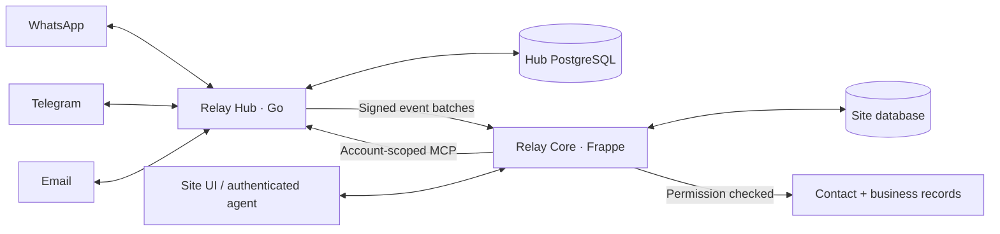

# Data model and message flow

A Hub account belongs to one Frappe site. Several provider channels can serve that
account. Core keeps business ownership and permissions on that site.

## Records

| Record | Responsibility |
| --- | --- |
| Frappe Contact / Dynamic Link | Existing business contact and linked business records |
| Relay Contact Type | Which business DocTypes Relay is allowed to resolve |
| Relay Contact | Communication projection for a Contact |
| Relay Channel | Provider and Hub account enabled on this site |
| Relay Contact Endpoint | Explicit verified association of a channel address/group with a Relay Contact |
| Relay Hub Event | Durable incoming event and projection status |
| Relay Message | Conversation content, provider route, structured media/contact/location data, reactions |
| Relay Message Action | Manual typed-send intent, stable request key, and provider submission result |
| Relay Ticket / Relay Ticket Message | Ticket and references to its source messages |
| Relay Automation Policy / Run / Outbox | Allowed AI decisions and durable, checked outbound intent |

See the [actual schemas](../relay_core/relay_core/doctype/) for fields, types,
indexes, and permissions. New records use Relay-prefixed names and Frappe naming
series. Hashes are used for deduplication/binding keys where needed, not to replace
every document's visible name.

## Contact lifecycle

Messages belong to the Relay Contact and its endpoint. The business on a message is the routing decision for that conversation. A reader needs read access to that business record, and the Contact must still link to it.

| Contact change | Result |
| --- | --- |
| Number or email changes only in format (`+91`, spaces, leading `0`) | No change. National numbers use the System Settings country code. |
| Number or email removed or replaced | The old endpoint becomes unverified at once. Its messages stay on the Relay Contact. |
| Replacement saved by a Relay manager or System Manager | Core also verifies the new value, unless another endpoint already holds it. |
| Business link removed | Routing, outbound send and message access for that business stop at once. |
| Delete | Blocked while a Relay Contact exists. Remove numbers or links, or merge the Contact. |
| Merge into a Contact without Relay history | The Relay Contact moves to the target Contact. Merging two Contacts that both have Relay history is blocked. |

One person has one Contact, linked to all their business records. When a sender has two or more linked businesses, routing asks the sender which one. One endpoint belongs to one Relay Contact, so a number that is already enrolled stays with its first Contact.

## Receive and reply

1. Hub authenticates the provider callback and records the event.
2. Hub delivers a signed, account-specific batch to Core.
3. Core records the event once and resolves its verified endpoint.
4. A new incoming message projects to Relay Message. Unknown endpoints remain
   uncategorized. Service events are not new user questions.
5. An agent selects a source message and submits content with a stable request
   key. Core derives the recipient, group, topic, and quote from that message.
6. Hub invokes the provider. Core records submission or uncertainty.

Provider acceptance and recipient delivery are different outcomes. A successful
manual send records `Submitted`; it does not prove that a recipient read it.

## Groups, topics, and edits

The group chat is the destination; the participant is message provenance. A
Telegram topic remains part of the conversation route. A participant's direct
chat is separate from the group conversation.

Reactions update the target message instead of creating a fresh conversational
message. Telegram edits replace the target's content. Duplicate or older updates
must not undo newer state. Automation rechecks source content and routing before
dispatch so an edited or superseded turn cannot silently send an older decision.

## Bounded work

Contacts and messages use database cursor pages. Searches execute on the server;
the current contact search is subsequence matching, not typo correction.
Connected message UI retains a bounded history window. Sticker downloads and
animation decompression have explicit size/complexity limits.

These bounds do not establish automatic scale-out, million-row throughput, or
unlimited group history. Deployment capacity and retention still require
measurement and an operational policy.
