# Relay Core user guide

This guide is for owners, managers and staff who use Relay at `/relay` on your Frappe site. It tells you where to go, what to add, and what happens after you add it. Read part 1 to 3 once. Then use part 4 to 6 as a catalog when you need a page, a task or an answer.

Contents:

1. [What Relay Core is](#1-what-relay-core-is)
2. [Words used in this guide](#2-words-used-in-this-guide)
3. [Roles: who sees what](#3-roles-who-sees-what)
4. [Page by page catalog](#4-page-by-page-catalog)
5. [Recipes: step by step tasks](#5-recipes-step-by-step-tasks)
6. [What happens if](#6-what-happens-if)

## 1. What Relay Core is

Relay Core is the team inbox for WhatsApp inside your Frappe site.

Customers write to your business WhatsApp number. The separate Relay Hub service receives the message and passes it to Relay Core.

Relay Core shows the message in the Inbox of the staff who are allowed to see that customer.

When staff reply, the reply goes out from the same business number that the customer wrote to.

Relay Core also sends approved templates, bulk campaigns and automatic messages when a business document changes, such as an order confirmation when a Sales Order is submitted.

```text
Customer phone
     |  writes on WhatsApp
     v
Meta WhatsApp  --->  Relay Hub (holds the WhatsApp account and keys)
                          |  signed callback
                          v
                     Relay Core inbox at /relay (your Frappe site)
                          |  staff reply, template, campaign or business event
                          v
                     Relay Hub  --->  Meta  --->  Customer phone
                     (same business number the customer wrote to)
```

Today Relay shows WhatsApp only. The Email and Telegram chips in the Inbox show "soon".

## 2. Words used in this guide

| Word | Meaning |
| --- | --- |
| Channel | One business WhatsApp number that the Hub connects to this site. Relay creates the channel list from the Hub. You do not type numbers in by hand. |
| Contact | A person, from the standard Frappe Contact list. Relay links the contact's verified WhatsApp number to it. A contact is linked to one or more business records, such as a Customer or a Supplier. |
| Conversation | All messages between one contact and your business number. It shows as one row in the Inbox. |
| Team | A named group of staff, such as "Sales North". A conversation assigned to a team is visible to every member. |
| Folder | A personal label to sort your own Inbox, such as "Follow up". Only you see your folders. |
| Ticket | A to-do item made from a chat, with a subject, priority, owner, tagged colleagues and comments. |
| Template | A message that Meta approved in advance. Only a template can start a chat or reach a customer after the 24-hour reply window closes. |
| 24-hour reply window | WhatsApp lets you send free text and media only within 24 hours after the customer's last message. After that, you must send a template. |
| Campaign | One message sent to many numbers at once, now or at a set time. |
| Business event | A rule that sends a template automatically when a document is created, submitted or cancelled. |
| Document action | A "Send on WhatsApp" button on a Desk form, such as a Sales Order, that sends a template and an optional PDF. |
| Saved reply | A ready text that staff insert into a reply with one click. |
| Hub key | The Hub URL, Hub account name and Hub API token. They let Relay Core talk to Relay Hub. The Hub administrator gives them to you. |
| Callback secret | A long shared password. The Hub signs every message it sends to Core with it. Core rejects a message with a wrong signature. The same value must be in Core and in the Hub. |

## 3. Roles: who sees what

Give each staff member one Relay role in Desk (User form, Roles section). A user without a Relay role cannot open `/relay`.

| Role | For whom | Conversations they see |
| --- | --- | --- |
| Relay Communication User | Front-line staff | Only conversations of their own teams, conversations assigned to them, and business groups they took. |
| Relay Communication Team User | Supervisors who watch all teams | All conversations of all teams. |
| Relay Communication Manager | Managers | All conversations, plus setup of templates, campaigns, events, teams and billing. |
| System Manager | The owner or IT | Everything, including Settings, Hub connection, channels and health. |
| Relay Hub Service | Not a person. One API user for the Hub. | None. It cannot open Desk or `/relay`. It is only for Hub callbacks. |

The Relay role alone decides which conversations a user sees. The user does not need ERPNext roles for this. The linked customer or supplier (name, ledger and other record data) shows only when the user can read that record in ERPNext. Otherwise the chat shows only the contact's name and phone.

A chat without a team or an assigned user is visible only to Team Users, Managers and System Managers. A Relay Communication User does not see it.

Menu and actions by role:

| Menu item or action | User | Team User | Manager | System Manager |
| --- | --- | --- | --- | --- |
| Inbox: read, reply, notes, folders, star | Yes | Yes | Yes | Yes |
| Inbox: assign a conversation to a team or person | No | No | Yes | Yes |
| Tickets: create, tag, comment | Yes | Yes | Yes | Yes |
| Tickets: change the assignee on the ticket page | No | No | Yes | Yes |
| Contacts & Links: view | Yes | Yes | Yes | Yes |
| Contacts: New contact, Unlinked senders | No | No | Yes | Yes |
| WhatsApp > Templates: view | Yes | Yes | Yes | Yes |
| WhatsApp > Templates: create, edit, delete | No | No | Yes | Yes |
| WhatsApp > Bulk campaigns, Forms | No | No | Yes | Yes |
| WhatsApp > Billing | No | No | Yes | Yes |
| Business events | No | No | Yes | Yes |
| Teams & Access | No | No | Yes | Yes |
| Saved replies: create and edit (in Desk) | No | No | Yes | Yes |
| Send on WhatsApp form button | Per action | Per action | Per action | Per action |
| AI skills (only when AI is on) | No | No | Yes | Yes |
| Settings & Setup, Activity & Health | No | No | No | Yes |
| Turn AI features on or off | No | No | No | Yes |

The Send on WhatsApp button shows for the roles set on each action. When the Roles table is empty, every Relay user who can read the document sees it.

AI is off by default. While "Enable AI features" is off, Relay shows no AI skills page, no conversation summary, no translation and no AI controls on tickets. Business events, templates and campaigns still work.

## 4. Page by page catalog

The left menu is a narrow rail. Point at it to see the names. On a phone, the menu is a bar at the bottom of the screen.

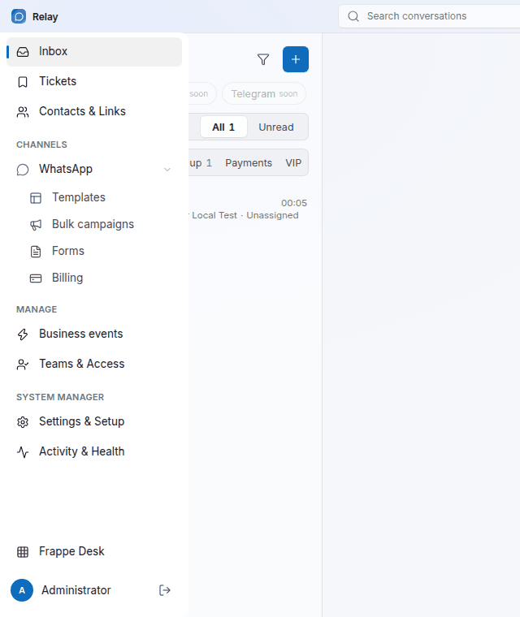

The top bar has the conversation search (Ctrl K), the "Live" badge and the bell. "Live" means updates arrive at once. If it shows another word, refresh the page. The bell lists your notifications. A small card also appears at the top right when someone assigns you a ticket or tags you.

At the bottom of the menu, "Frappe Desk" opens Desk, and the arrow button signs you out.

### 4.1 Inbox

Who: every Relay role.

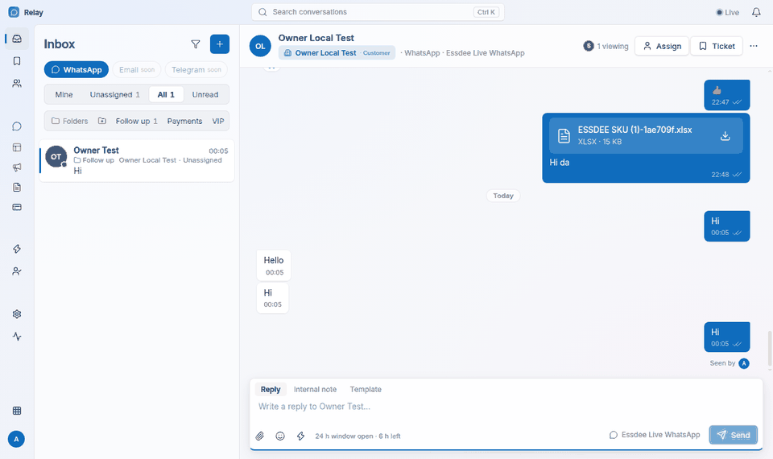

Left side, from top to bottom:

| Item | What it does |
| --- | --- |
| Filter icon | "Businesses" shows the list by business record, so you see all contacts of one customer together. Managers also get "Unlinked senders". |
| Plus button | Opens "New conversation". Pick a contact, then send a message or an approved template. |
| WhatsApp chip | Shows WhatsApp chats. Email and Telegram show "soon". |
| Number filter | Shows only when the site has two or more WhatsApp numbers. Pick one number to see only its chats. |
| Mine | Conversations assigned directly to you. |
| Unassigned | Conversations with no team and no person. |
| All | Every conversation you can see. |
| Unread | Conversations with new customer messages. |
| Folders row | Your personal folders with counts. Click a folder to filter. The folder-plus button makes a new folder. The "..." button renames or deletes the selected folder. |
| Conversation row | Name, time, last message, folder, business record and assignee. Right-click a row for "Move to folder" and "Remove from folder". |

Conversation header, right side:

| Button | What it does |
| --- | --- |
| Viewing | Shows other staff who have this chat open, so two people do not reply at once. |
| Assign | Opens "Organize conversation". Managers pick a team and an agent, then "Save assignment". |
| Ticket | Opens "Create ticket" for this chat. |
| "..." menu | Star conversation, Mark read, Move to folder, Remove from folder, Delivery failures and retry, Internal notes, Cases, Topics, Business context, Search conversation. Conversation summary shows only when AI is on. |

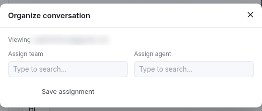

Message menu (point at a message):

| Item | What it does |
| --- | --- |
| Message info | Shows sent, delivered and read times. |
| Download attachment | Saves the file. |
| Discuss internally | Opens an internal note on this message. The customer never sees it. |
| Create ticket | Opens "Create ticket" with this message quoted. |
| React / Clear reaction | Sends or removes an emoji reaction. |

Reply box:

| Item | What it does |
| --- | --- |
| Reply tab | Write a normal reply. Enter sends. |
| Internal note tab | Write a note for staff only. Mentioned colleagues get a notification. |
| Template tab | Opens the template picker. Use it when the reply window is closed. |
| Paperclip | Adds a photo, video, audio, document, location or contact card. Files can be up to 4 MiB. It is off when the reply window is closed. |
| Smiley | Inserts an emoji. |
| Lightning | Opens saved replies. |
| "24 h window open · N h left" | Time left to send free text. When it closes, the box says "The WhatsApp reply window is closed" and offers "Use an approved template". |
| Number name next to Send | The business number the reply goes out from. It is the number the customer wrote to. |

What happens after you send: the message shows at once with one tick. The ticks change when WhatsApp reports sent, delivered and read. If sending fails, the message shows as failed. Open "..." > "Delivery failures and retry" to see why.

New conversation dialog:

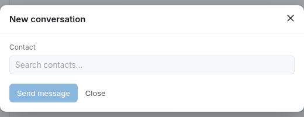

Search a contact. Relay lists the contact's verified numbers under "Send through". If the reply window is open you can choose "Message". If it is closed, only "Approved template" is possible. Click "Load approved templates", pick one and fill each variable box.

### 4.2 Tickets

Who: every Relay role.

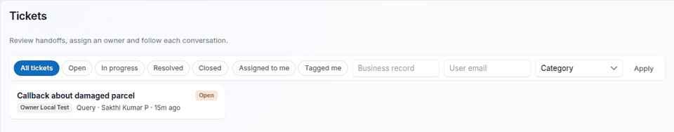

| Item | What it does |
| --- | --- |
| Status chips | All tickets, Open, In progress, Resolved, Closed. |
| Assigned to me, Tagged me | Your own tickets. |
| Business, Assignee, Category, Apply | Filter by business record, user email or category (Query, Payment evidence, Support, Other). |
| Ticket card | Opens the ticket on the right. |

Ticket page:

| Item | What it does |
| --- | --- |
| Open conversation | Jumps to the linked chat. |
| Tagged colleagues, Save tags | Add or remove up to 20 colleagues. Newly tagged people get a notification. |
| Comments, Add comment | Internal discussion. Pick colleagues in the mention box to notify them. |
| Assign to, Assign | Managers change the owner. The new owner gets a notification. |
| Start work | Sets the status to In progress. |
| Close ticket | Sets the status to Closed. |

You cannot make a ticket from the Tickets page. You make it from a chat (see recipe 5.7).

Relay also makes a ticket by itself called "Incoming conversation needs triage" when an unknown number writes, if the channel has a Company and a Triage owner in Desk. The triage owner gets it.

### 4.3 Contacts & Links

Who: every Relay role can view. Managers and System Managers can add.

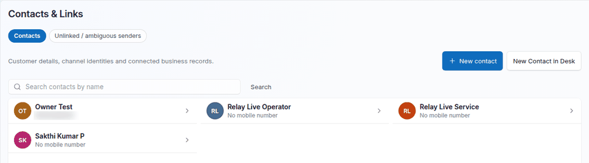

| Item | What it does | Who |
| --- | --- | --- |
| Search | Finds contacts by name. | All |
| Contact row | Opens the contact details on the right. | All |
| New contact | Asks Name, WhatsApp number with country code, WhatsApp channel and "Link to" a business record. Saves a Frappe Contact and marks the number as a verified WhatsApp identity. | Manager, System Manager |
| New Contact in Desk | Opens the standard Desk form. | Users with Desk rights |
| Unlinked / ambiguous senders tab | Messages from numbers Relay does not know, or from numbers linked to more than one business. Click "Link sender" or "Choose business", pick the contact and the business record, then "Link sender and load history". The old messages then appear in the Inbox. | Manager, System Manager |

Contact details show:

| Part | What it does |
| --- | --- |
| Channel identities | The verified WhatsApp numbers of the person. "Revoke identity" stops matching that number to this person. |
| Contact and business links | The Customer or Supplier records of the person. "Link a business record" adds one. "Remove" deletes the link. When there are several, the primary record shows in the chat header. |
| Business channel preferences | Consent and priority per business. Only a System Manager can change consent. |

What breaks if you change it: if you remove or change a number on the Contact in Desk, messages from the old number stop going to this person at once. They go to Unlinked senders until you link them again.

### 4.4 WhatsApp

Who: every Relay role sees the WhatsApp page. Some tabs are for managers only. The header shows the Hub account and "Connected" or "Needs setup".

#### Templates

Who: all can view. Managers and System Managers can create, edit and delete.

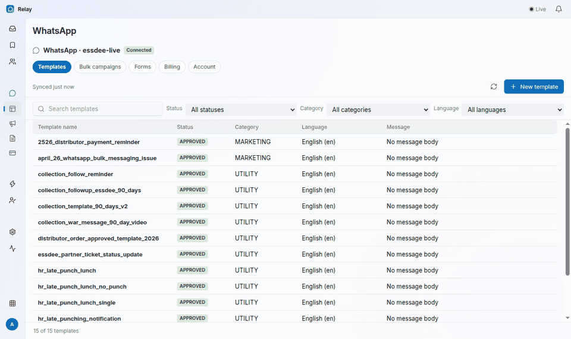

| Item | What it does |
| --- | --- |
| Refresh | Reads the template list again from the Hub. |
| New template | Opens the template editor. |
| Search, Status, Category, Language | Filters the list. |
| Template row | Opens the template: status, "Reason from Meta" for a rejected template, category, language, header, body, footer and buttons. "Edit" and the bin button change or delete it. |

Template editor:

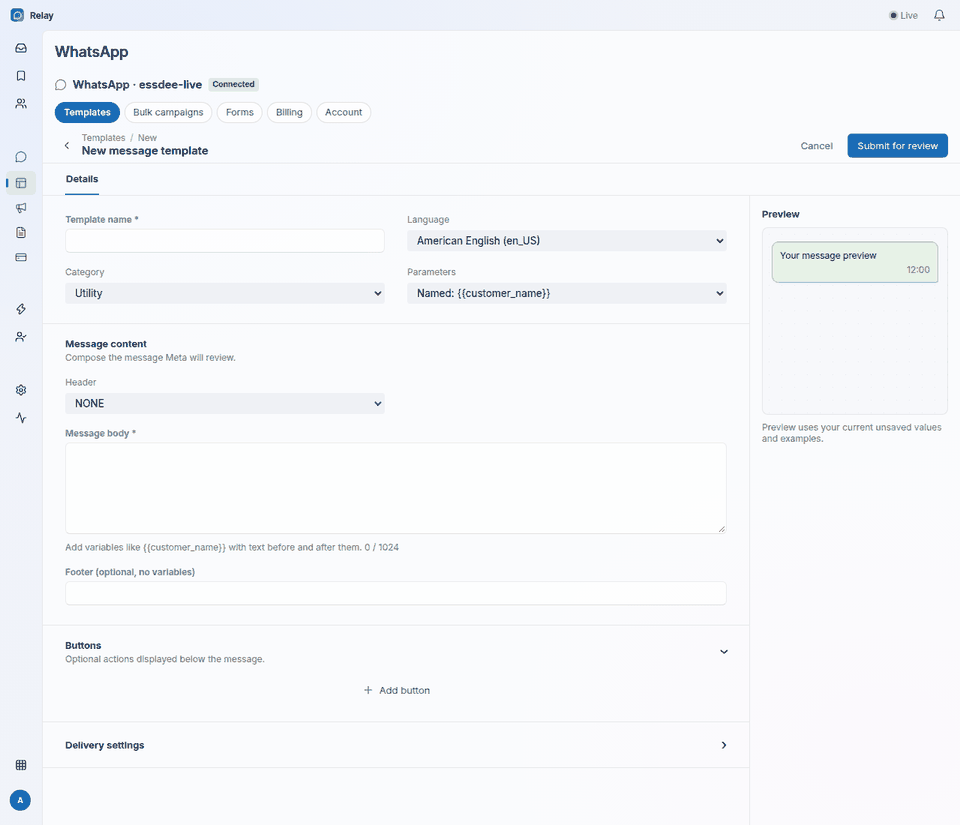

| Field | What to put |
| --- | --- |
| Template name | Lower case words joined by underscores, such as `order_confirmation`. |
| Language | The language of the text. |
| Category | Utility for order and account messages. Marketing for offers. Authentication for login codes. |
| Parameters | Named, such as `{{customer_name}}`, or Numbered, such as `{{1}}`. |
| Header | None, text or media. |
| Message body | The text, up to 1024 characters. Put text before and after each variable. |
| Footer | Optional short text without variables. |
| Review examples | A sample value for each variable. Meta reads them during review. |
| Buttons | Optional: website link, phone call, quick reply, copy code and others. |
| Submit for review | Sends the template to Meta. |

What happens after you submit: the status is PENDING. Meta decides, usually within minutes, sometimes later. The list then shows APPROVED or REJECTED. Only APPROVED templates appear in pickers, campaigns, business events and document actions.

What breaks if you delete it: Delete removes the template from Meta. Business events and Send on WhatsApp buttons that use it stop sending.

#### Bulk campaigns

Who: Manager and System Manager.

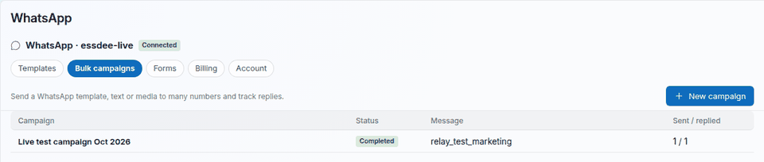

The list shows each campaign with its status and "Sent / replied" counts. "New campaign" starts one. See recipe 5.5.

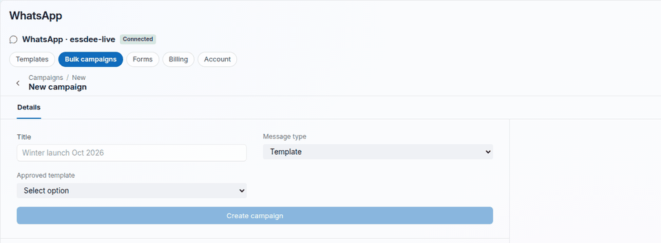

| Status | Meaning | Buttons |
| --- | --- | --- |
| Draft | Created, recipients can still change. | Start sending, Cancel campaign |
| Scheduled | Waits for the start time. | Send now, Unschedule, Cancel campaign |
| Running | Sending now. | Pause, Cancel campaign |
| Paused | Stopped for now. | Resume, Cancel campaign |
| Completed, Cancelled | Finished. | None |

The campaign page shows Recipients, Waiting, Sent, Delivered, Read, Replied, Failed and Skipped, a "Rows not sent" list with reasons, and a recipients table you can filter.

#### Forms

Who: Manager and System Manager. This tab lists WhatsApp Forms (Meta Flows) that belong to your WhatsApp account. You make the forms in Meta. Relay shows them so staff can send a published form from a chat.

#### Billing

Who: Manager and System Manager.

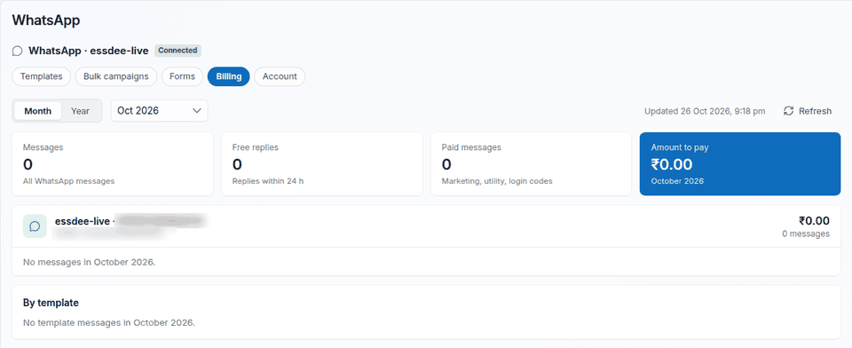

Pick Month or Year and a period. The cards show all messages, free replies (inside 24 hours), paid messages and the amount to pay. The amount includes the service charge that a System Manager sets in Settings. Each number has a statement, and "By template" shows the cost per template.

#### Account

Shows the Hub account and the sending number with its verified name and quality rating. Links go to the Hub connection and to the channel setup.

### 4.5 Business events

Who: Manager and System Manager.

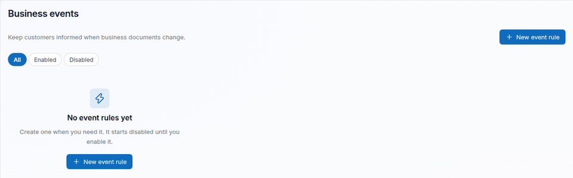

A business event rule sends a template when a document changes. "New event rule" opens the form. A new rule starts disabled. The chips filter All, Enabled and Disabled.

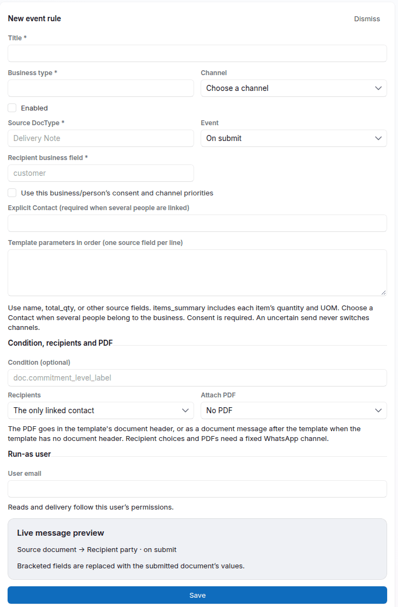

| Field | What to put |
| --- | --- |
| Title | A clear name, such as "Sales Order confirmation". |
| Business type | The DocType of the customer side, such as `Customer`. |
| Channel | The WhatsApp number that sends. |
| Enabled | Tick to make the rule live. A rule can be saved disabled before its template is approved. |
| Source DocType | The document that triggers it, such as `Sales Order`. |
| Event | On submit, When created or On cancel. |
| Recipient business field | The field on the document that links to the business type, such as `customer`. It must be a Link field to that business type. |
| Approved WhatsApp template | Type part of the template name and pick it from the list. Each row shows the name, the language, the status and the sending number. Approved templates show first. With a fixed Channel, the list shows only the templates of that number. |
| Use this business/person's consent and channel priorities | Leave off for a fixed WhatsApp number. Recipient choices and PDFs need it off. |
| Explicit Contact | One contact to send to. Needed when several people are linked to the business and Recipients is left on "The only linked contact". |
| Template parameters in order | One document field per line, for `{{1}}`, `{{2}}` and so on, such as `customer_name`, `name`, `grand_total`. `items_summary` gives each item with its quantity and unit. |
| Condition (optional) | A short rule on `doc`, such as `doc.grand_total > 0`. The rule sends only when it is true. |
| Recipients | The only linked contact (default), Primary contact, All business contacts (every WhatsApp number of every contact), or Document contact field. |
| Contact field | With "Document contact field", the field name, such as `contact_person`. |
| Attach PDF | No PDF, Print Format of the document, or a Report. |
| Print format, Report, Report filters | Which print format or report. Report filters is JSON with `{{doc.field}}` values, such as `{"customer": "{{doc.customer}}"}`. |
| File name | Such as `Order_{{doc.name}}.pdf`. |
| User email (Run-as user) | A user with the Relay Communication Manager role. Relay reads the document and sends as this user. |
| Live message preview | Shows how the text will look. |
| Save | Saves the rule. Relay checks the fields and lists any problem above the Save button. |

What happens after you save an enabled rule: the next matching document sends the template after the document is saved. If the template has a document header, the PDF goes in the header. If not, the PDF follows as a separate document message. The sent message shows in the customer's chat with the PDF.

What breaks if it fails: the document still saves. Relay never blocks a submit because of a message. The failure goes to the Desk Error Log as "Relay business event failed".

### 4.6 Send on WhatsApp button (Desk forms)

Who sets it up: Manager or System Manager, in Desk at Relay Document Action. Who uses it: the roles in its Roles table, or every Relay user who can read the document when the table is empty.

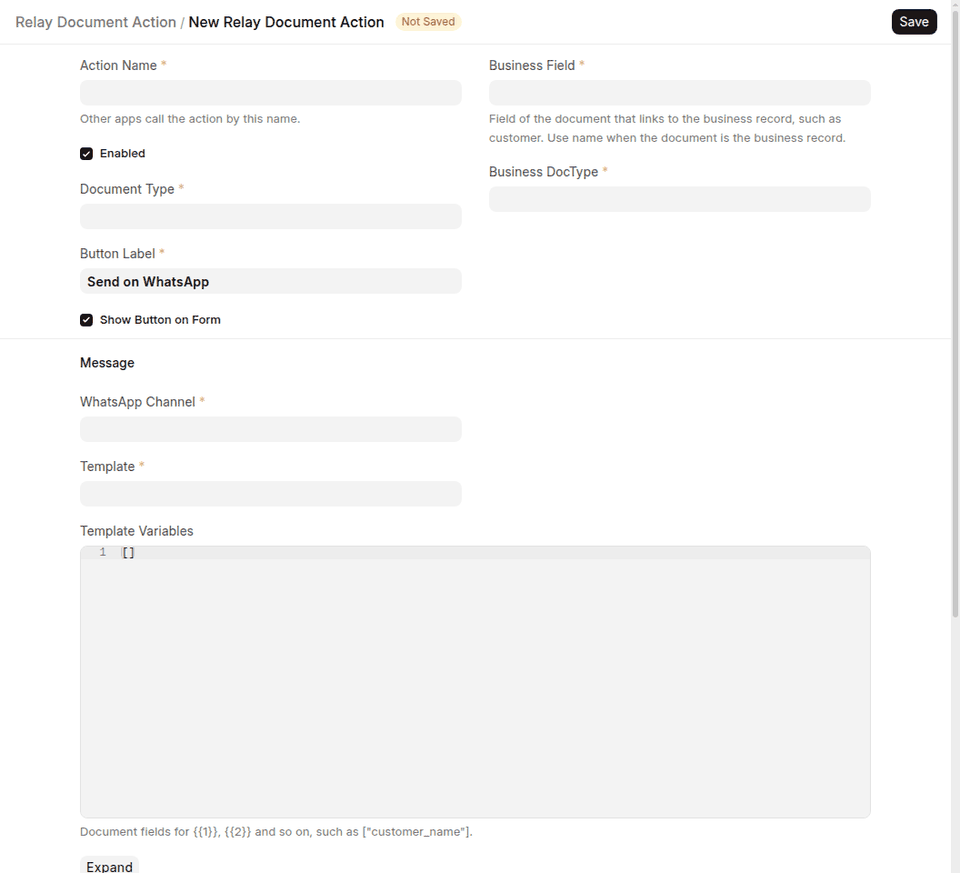

| Field | What to put |
| --- | --- |
| Action Name | A unique name. Other apps call the action by this name. |
| Enabled | Tick to show the button. |
| Document Type | The form that gets the button, such as `Sales Order`. |
| Button Label | Default "Send on WhatsApp". |
| Show Button on Form | Untick to hide the button but keep the action for other apps. |
| Business Field, Business DocType | The field that links to the customer, such as `customer` and `Customer`. Use `name` when the document is the customer itself. |
| WhatsApp Channel, Template | The sending number and an approved template. |
| Template Variables | Document fields for `{{1}}`, `{{2}}`, as a list, such as `["customer_name", "name"]`. |
| URL Button Variables | Document fields for the changing part of each link button. |
| Recipients, Contact Field | Primary contact, All business contacts or Document contact field. |
| Attach PDF, Print Format, Report, Report Filters, File Name | Same as in business events. |
| Roles | Who sees the button. |

What happens: after you save the action and reload Desk, the button shows on saved documents of that type. The button opens a dialog with the filled template, the PDF name and the contacts with their numbers. Tick the contacts and click "Send". A green note says how many numbers got it. A list shows any number that failed and why.

### 4.7 Teams & Access

Who: Manager and System Manager.

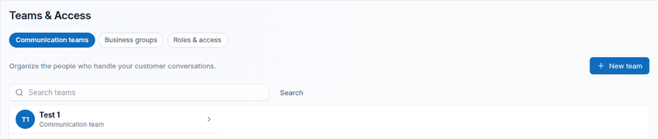

| Tab | What it does |
| --- | --- |
| Communication teams | "New team", Team name, "Add member", "Remove", "Save team". A team needs at least one member. Members see every conversation assigned to the team. |
| Business groups | Groups business records by the grouping field set in Business types (for example, by territory). Open a group and click "Take group" to become the handler. "Release" gives it back. A Relay Communication User then sees the conversations of the group. |
| Roles & access | Explains the four roles and links to Users and roles, Role permissions and User permissions in Desk. |

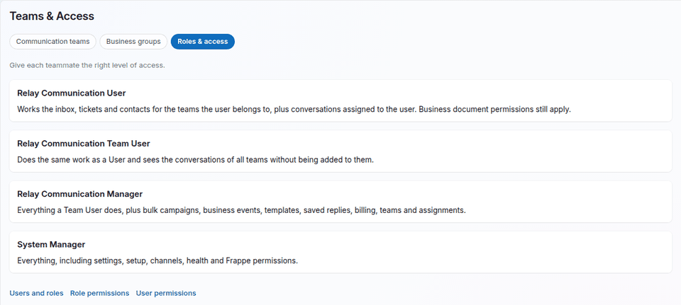

What breaks if you change it: when you remove a member from a team, that person stops seeing the team's conversations at once, unless the chat is assigned to them or their role sees all teams.

### 4.8 Settings & Setup

Who: System Manager.

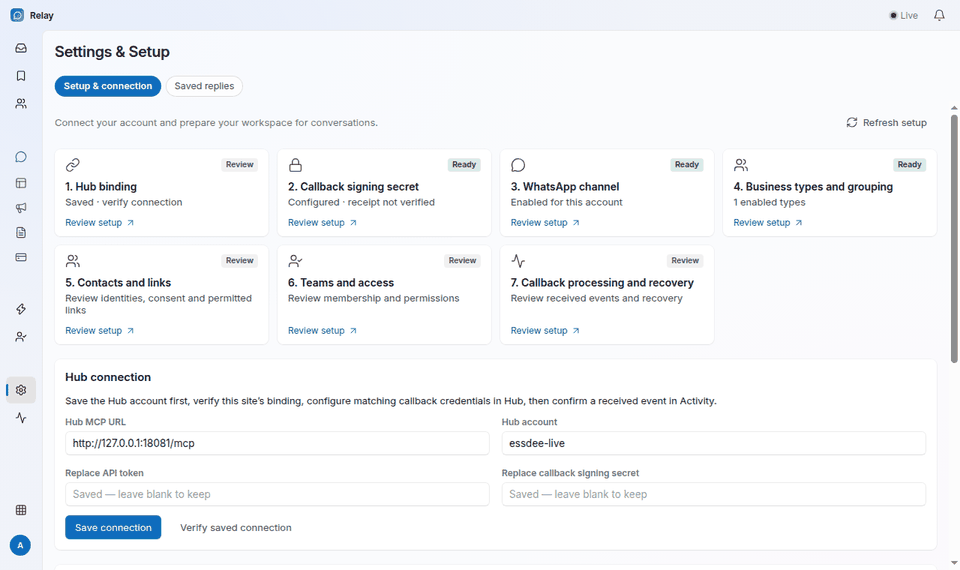

The setup cards show what is ready: Hub binding, Callback signing secret, WhatsApp channel, Business types and grouping, Contacts and links, Teams and access, and Callback processing and recovery. Click a card to go to that step.

Hub connection:

| Field | Where the value comes from |
| --- | --- |
| Hub MCP URL | The Hub administrator. It ends with `/mcp`, such as `https://hub.example.com/mcp`. |
| Hub account | The account name of this site in the Hub. |
| Replace API token | The Hub API token for this account. It must include `account:read`. Leave blank to keep the saved one. |
| Replace callback signing secret | A random text of 32 to 512 characters. Put the same text in the Hub. Leave blank to keep the saved one. |
| Save connection | Checks with the Hub that the account belongs to this site URL, then saves and reads the channel list. |
| Verify saved connection | Checks the saved values again. |

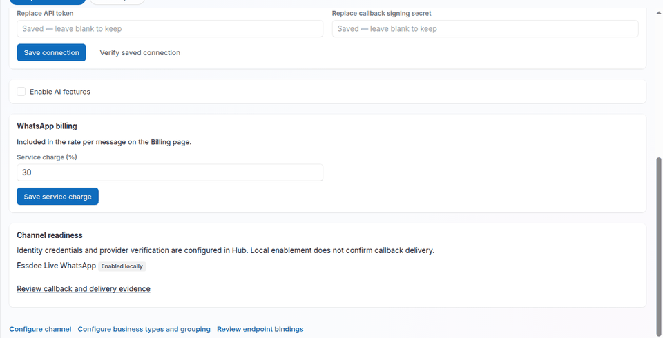

| Item | What it does |
| --- | --- |
| Enable AI features | Shows or hides all AI pages and controls. Off by default. |
| WhatsApp billing: Service charge (%) | Added to Meta's price on the Billing page. |
| Channel readiness | The numbers the Hub gave to this site and whether each is enabled. |
| Configure channel | Opens Relay Channel in Desk: label, default number, Company and Triage owner. |
| Configure business types and grouping | Opens Relay Contact Type in Desk: which DocTypes are customers (such as Customer, Supplier) and the grouping field. |
| Review endpoint bindings | Opens the list of verified numbers in Desk. |
| Saved replies tab | Lists saved replies. "Create in Desk" and "Edit in Desk" open the Relay Canned Reply form. Tick "Published" so staff see it. |

More switches are only in Desk at Relay Settings:

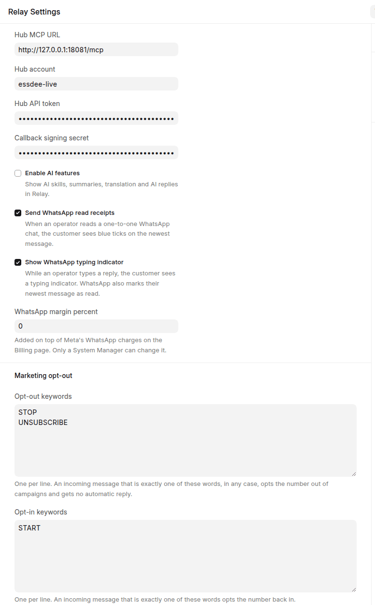

| Field | What it does |
| --- | --- |
| Send WhatsApp read receipts | When staff read a chat, the customer sees blue ticks. On by default. |
| Show WhatsApp typing indicator | The customer sees "typing" while staff type. On by default. |
| Opt-out keywords | One per line. Default STOP and UNSUBSCRIBE. |
| Opt-in keywords | One per line. Default START. |

### 4.9 Activity & Health

Who: System Manager.

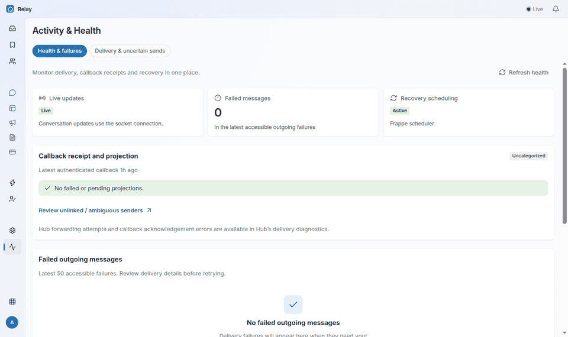

| Part | What it tells you |
| --- | --- |
| Live updates | Live means the browser gets updates at once. |
| Failed messages | Count of recent outgoing failures. |
| Recovery scheduling | Active means the Frappe scheduler runs the Relay repair jobs. |
| Callback receipt and projection | When Core last got a message from the Hub, and any failed or waiting events. "Review callback" opens one event in Desk. |
| Failed outgoing messages | The last 50 failures. Click one to open its chat. |
| Delivery & uncertain sends tab | Sends where the result is not known. You can record the result or cancel the delivery. It also has "Check WhatsApp sync" for the number profile and template sync. |

## 5. Recipes: step by step tasks

### 5.1 First setup (owner or IT, System Manager)

1. Ask the Hub administrator for four things: the Hub MCP URL, the Hub account name, a Hub API token with `account:read`, and confirmation that the Hub has your site URL. The site URL in the Hub must be the same as the site's `host_name`.
2. Make a callback secret: a random text of at least 32 characters. Keep it in your password manager.
3. In Desk, make an API user for the Hub. Open User > New. Use an email such as `relay-hub@yourcompany.com`. Give it only the role Relay Hub Service. Save. Open Settings > API Access > Generate Keys. Copy the API key and API secret.
4. Give the Hub administrator the API key, the API secret, the callback secret and your site URL. The Hub sends callbacks to `/api/method/relay_core.inbound.receive` on your site.
5. In `/relay`, open Settings & Setup. Fill Hub MCP URL, Hub account, Replace API token and Replace callback signing secret. Click "Save connection". Then click "Verify saved connection".
6. Check the WhatsApp channel card says "Ready". Click "Configure channel" and set a Company and a Triage owner on each number.
7. Click "Configure business types and grouping". Add an enabled Relay Contact Type for Customer (and Supplier if needed). Optional: set a Grouping Field, such as territory.
8. Send a WhatsApp message from your own phone to the business number. Open Activity & Health and check "Latest authenticated callback" shows a recent time. Open the Inbox or Contacts > Unlinked senders to see the message.

What happens: Core reads the list of numbers from the Hub and makes one channel per number. New messages arrive in seconds.

### 5.2 Give a staff member access (Manager or System Manager)

1. In Desk, open the person's User. Add one Relay role from the table in part 3. Most staff get Relay Communication User.
2. Give normal Frappe read permission on Contact and on Customer (or the business DocTypes you use). Use User Permissions if they may see only some customers.
3. In `/relay`, open Teams & Access > Communication teams. Open a team or click "New team". Use "Add member", then "Save team".
4. Assign conversations to the team: open a chat, click "Assign", pick the team, "Save assignment".

What happens: the person sees the team's conversations in Inbox > All, and chats assigned to them in Mine. A Team User or Manager sees all teams without being a member.

### 5.3 Reply to a customer (all staff)

1. Open the Inbox. Click the conversation.
2. Look at the hint next to the smiley: "24 h window open · N h left".
3. If the window is open, type in the Reply box and press Enter, or click Send. Use the paperclip for a file and the lightning for a saved reply.
4. If the window is closed, click "Use an approved template" or the Template tab. Pick the template, fill the variables, click "Send message".
5. To answer a specific message, point at it and use Reply. To talk with colleagues without the customer, use the Internal note tab.

What happens: the reply goes from the same business number the customer wrote to. Ticks show delivery and read status.

### 5.4 Create and submit a template (Manager or System Manager)

1. Open WhatsApp > Templates > New template.
2. Fill Template name, Language, Category and Parameters.
3. Write the Message body. Add a header, footer or buttons if needed.
4. Fill a sample value for each variable under Review examples.
5. Click "Submit for review".
6. Wait. Click Refresh later. The status changes from PENDING to APPROVED or REJECTED.

Tips: do not start or end the body with a variable. Do not put an offer in a Utility template. Meta rejects both.

### 5.5 Run a bulk campaign (Manager or System Manager)

1. Open WhatsApp > Bulk campaigns > New campaign.
2. Type a Title. If you have several numbers, pick the WhatsApp number.
3. Pick the Message type. Use "Template" to reach everyone. Text, Photo, Video and Document reach only numbers that wrote to you in the last 24 hours.
4. Pick the Approved template, or write the text. In text you can use `{{column}}` to fill a value from a sheet column.
5. Click "Create campaign". The campaign opens as a Draft.
6. Under Recipients, choose "Relay contacts" or "Upload a file".
7. With Relay contacts: filter by Tag, Linked to (business type and its segments), Number contains, and Last message from and to. The line under the filters shows how many numbers match. Use "Add a contact" and "Remove" for single people. Under Message values, pick a contact or record field for each template variable, or type the same value for all. Click "Add N numbers".
8. With a file: upload an `.xlsx` or `.csv`. Pick the Phone number column and a column or fixed value for each variable. Click "Check and import rows".
9. Under When to send, choose "Send now" and click "Start sending", or choose "Schedule at", pick the start time and click "Schedule".
10. Watch the counters. Use Pause, Resume or Cancel campaign if needed.

What happens: numbers that opted out are skipped and show "Skipped: opted out". Replies to the campaign come into the normal Inbox and count as Replied. Adding recipients again replaces only the rows not sent yet.

### 5.6 Set up an order confirmation business event (Manager or System Manager)

1. Make sure a Utility template is APPROVED, for example body "Hi {{1}}, your order {{2}} for {{3}} is confirmed." with a Document header if you want the PDF in the header.
2. In Desk, open Relay Business Event Rule > New (or use Business events > New event rule in `/relay`).
3. Title: `Sales Order confirmation`. Business type: `Customer`. Channel: your WhatsApp number.
4. Source DocType: `Sales Order`. Event: On submit. Recipient business field: `customer`.
5. Template: search and pick the approved template.
6. Template parameters, one per line: `customer_name`, `name`, `grand_total`.
7. Recipients: Primary contact. Attach PDF: Print Format. Print format: your Sales Order print format. File name: `Order_{{doc.name}}.pdf`.
8. Run-as user: a user with Relay Communication Manager.
9. Tick Enabled. Save.
10. Submit a test Sales Order for a customer whose primary contact has your own number. Check your phone and the customer's chat in the Inbox.

If nothing arrives, open Desk > Error Log and search "Relay business event failed".

### 5.7 Use folders (all staff)

1. In the Inbox, click the folder-plus button in the Folders row. Type a name, such as "Follow up". Click "Create folder".
2. To file a chat, right-click its row, or open it and use "..." > "Move to folder". Pick a folder, or type a new name and click "Create and move".
3. Click a folder in the Folders row to see only its chats. Click it again to see all.
4. To rename or delete, select the folder and use its "..." button.

Only you see your folders. A chat can be in one of your folders at a time. Deleting a folder keeps its chats in your Inbox.

### 5.8 Raise and tag a ticket (all staff)

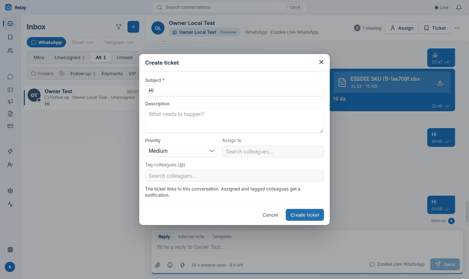

1. Open the chat. Click "Ticket" in the header, or point at a message and click "Create ticket".
2. Check the Subject. Write what must happen in Description.
3. Pick Priority: Low, Medium, High or Urgent.
4. In "Assign to", search a colleague. In "Tag colleagues (@)", add up to 20 people.
5. Click "Create ticket". A note says "Ticket created" with "Open ticket".

What happens: the ticket links to the chat and the business record. The assignee and tagged people get a notification in the bell and a card on screen. Only colleagues who can read this chat show in the search. On the ticket page, use comments with mentions to discuss, "Start work" and "Close ticket" to move it on.

### 5.9 Opt-outs (System Manager sets keywords, nothing to do for staff)

1. The default opt-out words are STOP and UNSUBSCRIBE. The default opt-in word is START. Change them in Desk > Relay Settings > Marketing opt-out, one word per line.
2. When a customer sends exactly one of these words, in any case, Relay marks that number as opted out or back in.

What happens: an opted-out number is skipped in every bulk campaign. The keyword message gets no automatic reply. Staff can still chat with the customer, and business events still send.

### 5.10 Import old WhatsApp Core messages (IT, server command)

Run this on the server in the bench folder. Always try a dry run first.

```sh
bench --site <your-site> relay-import-whatsapp-core \
  --source-db <old_database_name> \
  --source-password-file <file_with_db_password> \
  --source-site-label sales.example.com \
  --dry-run
```

| Option | Meaning |
| --- | --- |
| `--source-db` | The old site's database. Leave it out to read the WhatsApp Core tables of this same site. |
| `--source-host`, `--source-port`, `--source-user` | Where the old database is. The user defaults to `root`. |
| `--source-password-file` | A file with the database password. Or set `RELAY_SOURCE_DB_PASSWORD`. |
| `--source-site-label` | A fixed name for the old site. Required. It marks every imported message. |
| `--channel OLD=NEW` | Maps an old WhatsApp number to a Relay channel. Repeat it for each number. |
| `--files-dir` | The old private files folder. Media found there is copied. When the source is the same site, media found at their own URL on the site are copied too. |
| `--batch` | Messages per insert. Default 2000. |
| `--dry-run` | Counts only. Writes nothing. |
| `--undo` | Deletes everything that the import with this label created. |
| `--team` | Gives this Relay Team every imported chat that has no assignment yet. |

Steps:

1. Run with `--dry-run`. Read the counts.
2. Run again without `--dry-run`.
3. Open a few old customers in the Inbox and check the history.

What happens: each old chat is matched to a Relay contact by phone number and to the Relay channel of its number. A second run skips messages already imported and updates changed statuses. Imported messages never trigger automatic replies or opt-outs.

Imported chats have no team. Only Team Users, Managers and System Managers see them. To show them to a team of Relay Communication Users, assign them to that team. Chats that already have an assignment are not changed:

```sh
bench --site <your-site> relay-assign-imported-chats --source-site-label sales.example.com --team <Relay Team>
```

### 5.11 Troubleshooting

Messages are not arriving:

1. Activity & Health: is "Latest authenticated callback" recent? If not, the Hub cannot reach Core. Check the Hub has the right site URL, API key and secret of the Relay Hub Service user, and the same callback secret as Core.
2. Is the sender new? Look in Contacts > Unlinked / ambiguous senders and link the sender.
3. Does "Channel setup required" show there? Open Configure channel and enable the number. Then click "Verify saved connection" in Settings.
4. Recovery scheduling must say Active. If not, ask IT to start the Frappe scheduler and workers.
5. A staff member does not see a chat? Check their role, their team, and their Frappe permission on the customer.

You cannot send:

1. The reply box says the window is closed: send an approved template.
2. The paperclip is grey: the window is closed, or the file is over 4 MiB.
3. "No verified channel is available for this contact": add the number with Contacts > New contact, or link the sender from Unlinked senders.
4. The message shows failed: open "..." > "Delivery failures and retry", or Activity & Health > Failed outgoing messages.
5. Campaign rows show "Skipped": read the reason. "opted out" means the customer sent STOP.

A template was rejected:

1. Open WhatsApp > Templates and click the template. Read "Reason from Meta".
2. Fix the cause: wrong category, a variable at the start or end, missing samples, or a promotion in a Utility template.
3. Click "Edit", change it and click "Submit changes", or make a new template with a new name.

## 6. What happens if

| If you... | Then... |
| --- | --- |
| delete a folder | Its chats stay in your Inbox without a folder. Other people are not affected. |
| remove a person from a team | They stop seeing that team's chats at once, unless a chat is assigned to them or their role sees all teams. |
| give someone Relay Communication Team User | They see all teams' chats, but cannot change setup. |
| turn off "Enable AI features" | AI pages and buttons hide and AI background work stops. Inbox, templates, campaigns and business events keep working. |
| change the callback secret only in Core | The Hub's messages are rejected and no new messages arrive. Put the same secret in the Hub. |
| save a wrong Hub URL, token or account | Save connection checks with the Hub first. It shows an error and keeps the old values. |
| delete a template | Meta removes it. Rules and buttons that use it stop sending until you pick another template. |
| a customer sends STOP | The number is skipped in campaigns. You can still chat with them. They send START to opt back in. |
| a business event fails | The document still saves. The reason goes to Desk > Error Log. |
| you disable a business event rule | Nothing sends for new documents. Messages already sent stay. |
| you reply after 24 hours | Free text is blocked. Only an approved template can go out. |
| you cancel a running campaign | Rows not yet sent stop. Messages already sent stay sent. |
| you import campaign recipients again | Rows not yet sent are replaced. Sent rows stay. |
| you change or remove a number on a Contact in Desk | Messages from the old number stop going to that person at once and wait in Unlinked senders. |
| you click "Revoke identity" on a contact | That number is no longer matched to the person. New messages from it go to Unlinked senders. |
| the Hub disables a number | The next sync with the Hub disables that channel in Core. |
| you run the old message import twice | Messages already imported are skipped. Use `--undo` with the same label to remove an import. |
| two staff open the same chat | Each sees "N viewing" and who is typing, so only one replies. |
